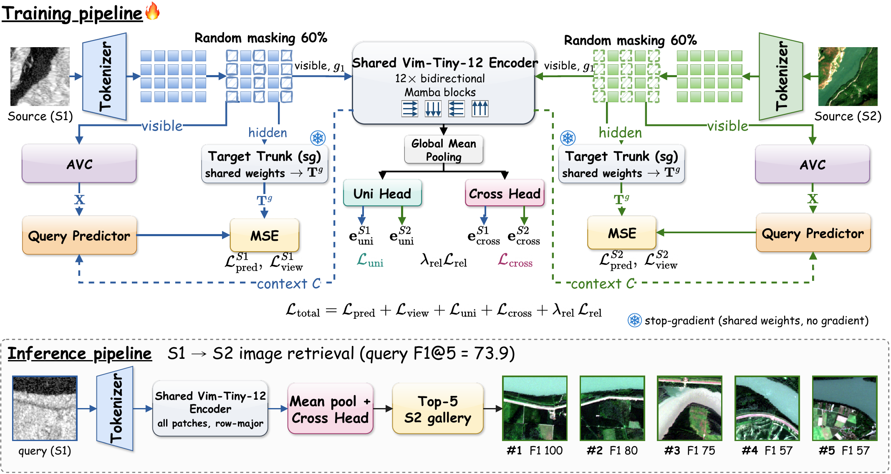

<div align="center">

# RS-JEPA: Remote Sensing Joint-Embedding Predictive Architecture with Scan-Path Views for Cross-Sensor Image Retrieval

[](https://arxiv.org/abs/2611.14496)
[](https://www.python.org/)
[](https://pytorch.org/)
[](LICENSE)
[](#-news)

**Tanishq Rachamalla**<sup>1</sup>, **Srishti Kaushik**<sup>1</sup>, **Muhammad Attique Khan**<sup>1</sup>, **Gustau Camps-Valls**<sup>2</sup>, **Swalpa Kumar Roy**<sup>3</sup>

<sup>1</sup> Prince Mohammad Bin Fahd University, Al Khobar, Saudi Arabia  
<sup>2</sup> Universitat de València, Valencia, Spain  
<sup>3</sup> Tezpur University, Assam, India  

Official PyTorch implementation of **RS-JEPA** ([arXiv:2611.14496](https://arxiv.org/abs/2611.14496)).

🎉 **Accepted at the CVE40 Workshop at WACV 2027.**

</div>

---

## 📰 News

- **Paper accepted** at the **CVE40 workshop** (held at WACV 2027).
- Paper released on arXiv: [2611.14496](https://arxiv.org/abs/2611.14496).

---

## 📌 Overview

Cross-sensor remote sensing image retrieval aims to rank scenes across heterogeneous sensors (e.g., SAR $\longleftrightarrow$ Optical or Panchromatic $\longleftrightarrow$ Multispectral) without manual annotations. Existing self-supervised approaches either reconstruct sensor-specific noise (e.g., SAR speckle), align only co-registered twins, or rely on large transformers (118–173M parameters, up to 398M).

**RS-JEPA** is a compact joint-embedding predictive architecture built on a single **Vision Mamba (Vim)** encoder shared by both sensors:
1. **Scan-Path Views:** Uses the inherent sequence-order sensitivity of selective state-space models (SSMs) to generate self-supervised views from different 1D scan traversals of the identical patch grid, avoiding pixel-corrupting data augmentations and momentum target encoders.
2. **Adversarial View Coupling (AVC):** A per-sensor linear scorer learned with a Gradient Reversal Layer (GRL) discovers the hardest split of visible tokens ($V_A, V_B$), coupled via four Coupled View Attention (CVA) blocks.
3. **Cross-Sensor Neighbourhood Consensus:** A teacher-free relational loss aligns the intra- and cross-sensor similarity neighborhoods of both sensors, enforcing geometric consistency across modalities.
4. **Extreme Efficiency:** The deployed retrieval network (the two stems plus the shared Vim encoder and retrieval heads) has **only 3.88M parameters** (14.57M during training, which adds the AVC / CVA view stacks and predictors) and needs **2.23 GFLOPs** per S1–S2 pair at 120×120, i.e. 8–16× fewer parameters than prior JEPA retrievers.

Like prior methods, RS-JEPA is trained on co-registered S1–S2 pairs; no class labels are used for pretraining.

<div align="center">


*Figure: RS-JEPA architecture. **Training (top):** each sensor is tokenized by its own stem and randomly masked (60%); the visible tokens go through the shared Vim-Tiny-12 encoder with scan-path views, Adversarial View Coupling (AVC) and a query predictor that regresses the hidden patches (MSE) from a stop-gradient target trunk, while the uni / cross heads and the neighbourhood-consensus loss align the two sensors. **Inference (bottom):** the query is tokenized, encoded without masking along the row-major scan, mean-pooled and projected by the cross head, then ranked against the other sensor's gallery (top-5).*
</div>

---

## 🚀 Benchmark Performance (Table 1 from Paper)

All methods were re-implemented and trained by us under one protocol (the paper compares against twelve re-implemented methods; the table below lists the main representatives of each family — see the paper for the full comparison). Params is the training model; GFLOPs is for one S1–S2 pair at 120×120 on the BEN-14K configuration. Evaluation is performed under symmetric bidirectional search at unified $120 \times 120$ resolution. Metric is **F1@5 (%)** across four retrieval directions ($1\to 1$, $2\to 2$, $1\to 2$, $2\to 1$) and their average.

| Method | Params (M) ↓ | GFLOPs ↓ | BEN-14K (SAR ↔ MS) Avg. | CBRSIR-VS (SAR ↔ RGB) Avg. | DSRSID (PAN ↔ MS) Avg. |
|:---|---:|---:|---:|---:|---:|
| MAE-RVSA (IEEE TGRS '22) | 172.23 | 50.33 | 67.58 | 66.46 | 75.84 |
| ScaleMAE (ICCV '23) | 215.07 | 51.12 | 67.40 | 67.74 | 74.23 |
| SatMAE++ (CVPR '24) | 223.57 | 106.18 | 67.47 | 67.55 | 77.79 |
| CROMA (NeurIPS '23) | 200.27 | 38.17 | 69.64 | 74.50 | 87.42 |
| DeCUR (CVPR '23) | 198.07 | 5.22 | 64.09 | 78.07 | 67.63 |
| SkySense (CVPR '24) | 173.24 | 51.13 | 68.41 | 67.81 | 88.44 |
| CR-JEPA (arXiv '26) | 115.18 | 14.74 | 69.81 | 65.46 | 73.79 |
| X-JEPA (WACV '26) | 230.47 | 32.98 | 67.79 | 73.18 | 86.86 |
| **RS-JEPA (Ours)** | **14.57 / 3.88** | **2.23** | **72.92** | **80.35** | **94.43** |

*Note: RS-JEPA reports 14.57M training parameters and 3.88M evaluation parameters.*

*Directional Breakdown for RS-JEPA:*
* **BEN-14K**: S1→S1: 70.93% | S2→S2: 72.55% | S1→S2: 73.86% | S2→S1: 74.33% (**Mean: 72.92%**)
* **CBRSIR-VS**: S1→S1: 76.39% | S2→S2: 86.54% | S1→S2: 78.72% | S2→S1: 79.75% (**Mean: 80.35%**)
* **DSRSID**: S1→S1: 93.77% | S2→S2: 93.73% | S1→S2: 95.10% | S2→S1: 95.14% (**Mean: 94.43%**)

---

## 📂 Repository Structure

```
RSJEPA_code/
├── README.md                      # Documentation and reproduction guide
├── LICENSE                        # MIT license
├── assets/                        # Architecture figure (PNG + vector PDF)
├── requirements.txt               # Environment dependencies
└── RSJEPA/
    ├── __init__.py                # Package initialization and exports
    ├── train.py                   # Self-supervised pretraining entry point
    ├── evaluate.py                # Bidirectional cross-sensor evaluation (F1@5, random floor / oracle ceiling)
    ├── models.py                  # RS-JEPA model classes (RSJEPABiDA is the final model), AVC router & CVA blocks
    ├── losses.py                  # Re-exports of training objectives
    ├── data.py                    # Re-exports of the dataset loaders
    └── helpers/
        ├── __init__.py            # Helper imports
        ├── stem.py                # Per-sensor patch-embedding stems
        ├── layers.py              # Predictor, transformer blocks, MLP, projection heads
        ├── losses.py              # Objective: InfoNCE, neighbourhood-consensus loss, prediction & view loss
        ├── data.py                # BEN14K, CBRSIR-VS and DSRSID datasets + loaders
        ├── retrieval.py           # Retrieval engine, F1@k, random / oracle baselines
        ├── vim.py                 # Vision Mamba wrapper: scan-path trajectories (4 scan orders), gap-aware scan
        └── vim_official/          # Self-contained Vision Mamba core (hustvl/Vim, Apache-2.0)
            ├── models_mamba.py    # Vision Mamba backbone
            ├── rope.py            # Rotary position embeddings
            └── LICENSE            # Upstream Apache-2.0 license
```

---

## 🛠️ Environment Setup

### 1. Requirements

- Python 3.10 or 3.11
- PyTorch 2.x with CUDA support
- NVIDIA GPU (the paper's experiments ran on NVIDIA V100 GPUs). The Mamba selective-scan kernels require CUDA.

### 2. Installation

Extract the archive (or clone the repository) and install the core dependencies. Install PyTorch first, matching your CUDA version:

```bash
cd RSJEPA_code
pip install torch torchvision --index-url https://download.pytorch.org/whl/cu121   # adjust to your CUDA
pip install -r requirements.txt
```

### 3. Vision Mamba CUDA Kernels

RS-JEPA's selective state-space encoder relies on the official hardware-accelerated Mamba CUDA kernels:

```bash
pip install "causal_conv1d>=1.4.0"
pip install "mamba_ssm>=1.1.1"
```

*(Prebuilt wheels for various CUDA / PyTorch versions are available on the [mamba-ssm releases](https://github.com/state-spaces/mamba/releases) and [causal-conv1d releases](https://github.com/Dao-AILab/causal-conv1d/releases) pages).*

---

## 🛰️ Datasets Preparation

Three paired two-sensor benchmarks are used. Pretraining uses the training part only (no labels); retrieval is measured on the evaluation part, which serves as both query set and gallery.

| Dataset | S1 / S2 | Classes | Pairs | Pretraining | Evaluation | Split |
|---|---|---|---|---|---|---|
| BEN-14K | Sentinel-1 SAR (VV, VH; 2 ch) / Sentinel-2 (12 bands) | 19, multi-label | 14,832 | 11,310 (train + validation) | 3,522 (test) | official BigEarthNet split |
| CBRSIR-VS | SAR (1 ch) / RGB optical (3 ch) | 10, single-label | 26,901 | 18,831 | 8,070 | stratified 70/30, seed 42 |
| DSRSID | Gaofen-1 PAN (1 ch) / MS (4 ch) | 8, single-label | 80,000 | 56,000 | 24,000 | stratified 70/30, seed 42 |

All images are 120×120 and z-scored per channel using `norm_stats.json`.

### 🔗 Dataset links and preparation code

🤗 **All three datasets (images, splits, normalisation stats, prep scripts) are on Hugging Face: [Tanishq165/RSJEPA](https://huggingface.co/datasets/Tanishq165/RSJEPA)**

```bash
hf download Tanishq165/RSJEPA --repo-type dataset --local-dir data
```

The downloaded folders (`benv1_14k/`, `cbrsir_vs/`, `dsrsid/`) match the `--data-root` paths used below. **DSRSID needs one extra step**: build its required 120 px caches once (needs `h5py`, included in `requirements.txt`):

```bash
python data/dsrsid/cache_dsrsid.py --mat data/dsrsid/raw/DSRSID.mat --root data/dsrsid
```

The BEN-14K and CBRSIR-VS caches (`cache_*_120.pt`) are optional speed-ups; without them the loaders read the images directly.

| Dataset | Original source | Files / preparation code (in the Hugging Face repo) |
|---|---|---|
| **BEN-14K** | BigEarthNet subset (Sentinel-1/2 pairs) of BigEarthNet-MM. Official site: [bigearth.net](https://bigearth.net) · Zenodo: [record 12687186](https://zenodo.org/record/12687186) · paper: [arXiv:2105.07921](https://arxiv.org/abs/2105.07921) (Sumbul et al.) | `benv1_14k/`: `s1/`, `s2/` (one `_all.npy` per patch), `ben14k_official_splits.parquet/csv`, `classes_19.json`, `norm_stats.json` |
| **CBRSIR-VS** | Sun et al., *IEEE TGRS* 60, 2022 (paper ref. [21]) | `cbrsir_vs/`: `sar/`, `optical/`, `index.csv`, `split_70_30.csv`, `norm_stats.json`, `make_70_30_split.py` (regenerates the split) |
| **DSRSID** | Li, Zhang, Huang, Ma, *"Learning source-invariant deep hashing convolutional neural networks for cross-source remote sensing image retrieval"*, *IEEE TGRS* 56(11), 2018 (paper ref. [14]) | `dsrsid/`: `raw/DSRSID.mat`, `index.csv`, `split_70_30.csv`, `norm_stats.json`, `cache_dsrsid.py` |

The loaders (`RSJEPA/helpers/data.py`) expect each dataset folder under `data/` (or any path given with `--data-root`) to contain the following files:

```
data/
├── benv1_14k/
│   ├── ben14k_official_splits.parquet   # official split + 19-class labels
│   ├── norm_stats.json
│   ├── s1/  s2/                         # per-patch <id>/<id>_all.npy (paths listed in the parquet)
│   └── cache_trainval_120.pt, cache_test_120.pt   # optional speed-up caches (not on the Hub)
├── cbrsir_vs/
│   ├── split_70_30.csv                  # (or index.csv)
│   ├── norm_stats.json
│   └── sar/  optical/                   # image pairs
└── dsrsid/
    ├── split_70_30.csv
    ├── raw/DSRSID.mat                   # source file for cache_dsrsid.py
    └── cache_train_120.pt, cache_test_120.pt      # REQUIRED, built with cache_dsrsid.py (DSRSID is only read from these)
```

> **Note:** this archive contains the model, training and evaluation code only. The images, split files, `norm_stats.json` and dataset scripts are on Hugging Face (link above). Which loader is used is chosen automatically from `--data-root`: a folder with `split_70_30.csv` is CBRSIR-VS or DSRSID (distinguished by its columns), otherwise BEN-14K.

## 🏋️ Training RS-JEPA

Train the full RS-JEPA model (Vim-Tiny-12 encoder, 10×10 patch size, 60% masking, scan-path views, Adversarial View Coupling, and neighbourhood consensus) for 100 epochs using AdamW (learning rate 1e-4 → 1e-3 over 15 warm-up epochs, then cosine decay to 1e-6, weight decay 0.04):

### Benchmark 1: BigEarthNet-14K (BEN-14K)

```bash
export PYTHONPATH=$PWD
python -u RSJEPA/train.py \
    --preset rsjepa_v2 \
    --data-root data/benv1_14k \
    --train-split train+validation \
    --s1-chans 2 --s2-chans 12 \
    --img-size 120 --patch-size 10 \
    --mask-ratio 0.6 \
    --epochs 100 --batch-size 290 --accum 1 --workers 8 \
    --seed 0 --out runs/ben14k_s0
```

### Benchmark 2: CBRSIR-VS

```bash
export PYTHONPATH=$PWD
python -u RSJEPA/train.py \
    --preset rsjepa_v2 \
    --data-root data/cbrsir_vs \
    --train-split train \
    --s1-chans 1 --s2-chans 3 \
    --img-size 120 --patch-size 10 \
    --mask-ratio 0.6 \
    --epochs 100 --batch-size 290 --accum 1 --workers 8 \
    --seed 0 --out runs/cbrsir_s0
```

### Benchmark 3: DSRSID

```bash
export PYTHONPATH=$PWD
python -u RSJEPA/train.py \
    --preset rsjepa_v2 \
    --data-root data/dsrsid \
    --train-split train \
    --s1-chans 1 --s2-chans 4 \
    --img-size 120 --patch-size 10 \
    --mask-ratio 0.6 \
    --epochs 100 --batch-size 290 --accum 1 --workers 8 \
    --seed 0 --out runs/dsrsid_s0
```

> **Note on flags:** `--preset rsjepa_v2` sets the architecture and loss of the paper model (`--backbone vim_tiny --depth 12 --dim 192 --heads 8 --pred-heads 8 --view-depth 4 --bida --traj-views --traj-select hardest --bida-mode adv --view-router random --lam-rel 1.0 --rel-tau 0.1 --rel-mode consensus --lam-sigreg 0 --uni-mode paper --lam-view-pred 1.0 --no-inter --pred-loss mse`). Data, image / patch size, mask ratio, epochs, batch size and seed stay under your control. The 10×10 patch size on 120×120 images gives a 12×12 token grid.
>
> `--batch-size` is the micro-batch; `--accum` (0 = automatic) accumulates gradients up to `--target-batch`. Checkpoints and logs are written to `--out`; use `--resume <ckpt>` to continue a run and `--smoke` for a quick sanity run.

---

## 📊 Evaluation

Evaluate a trained checkpoint with symmetric bidirectional retrieval on the test set:

```bash
export PYTHONPATH=$PWD
python RSJEPA/evaluate.py runs/ben14k_s0/last.pt --data-root data/benv1_14k --split test --batch 256
# CBRSIR-VS:  --data-root data/cbrsir_vs        DSRSID:  --data-root data/dsrsid
```

`--split test` is the evaluation part (for CBRSIR-VS and DSRSID it maps to the 30% `eval` split). The image size is read from the checkpoint.

At test time:
- The shared Vision Mamba encoder reads all tokens along the canonical row-major scan without masking.
- Gallery scenes are ranked by cosine similarity of the unit-normalized embeddings from the **uni head** (same-sensor: S1→S1, S2→S2) and **cross head** (cross-sensor: S1→S2, S2→S1).
- The script prints F1@5 for the four directions and their mean, together with the random-retrieval floor and oracle ceiling of the dataset, the effective rank of the embeddings, and the parameter count of the loaded model (this counts the full training model, 14.57M; the 3.88M figure in the paper is the deployed retrieval network).

---

## 📖 Citation

If you find this work or code useful in your research, please cite our paper (accepted at the CVE40 Workshop at WACV 2027; arXiv version below):

```bibtex
@article{rachamalla2026rsjepa,
  title={RS-JEPA: Remote Sensing Joint-Embedding Predictive Architecture with Scan-Path Views for Cross-Sensor Image Retrieval},
  author={Rachamalla, Tanishq and Kaushik, Srishti and Khan, Muhammad Attique and Camps-Valls, Gustau and Roy, Swalpa Kumar},
  journal={arXiv preprint arXiv:2611.14496},
  year={2026}
}
```

---

## 📜 License

This project is released under the [MIT License](LICENSE). Third-party code under `RSJEPA/helpers/vim_official/` is licensed under Apache-2.0 from [hustvl/Vim](https://github.com/hustvl/Vim).
